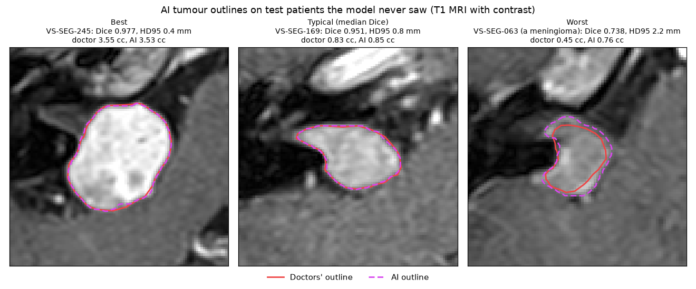
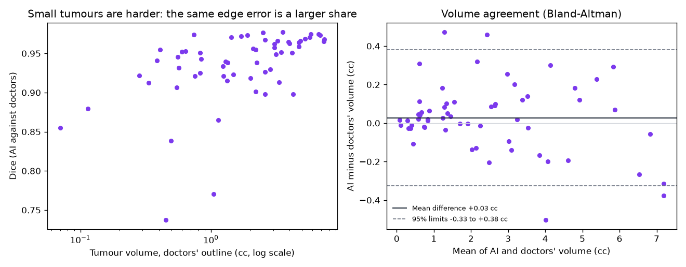
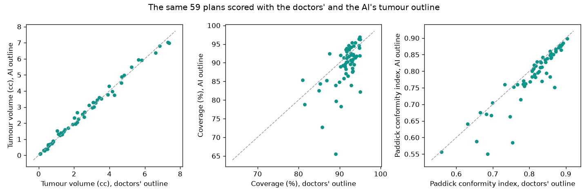
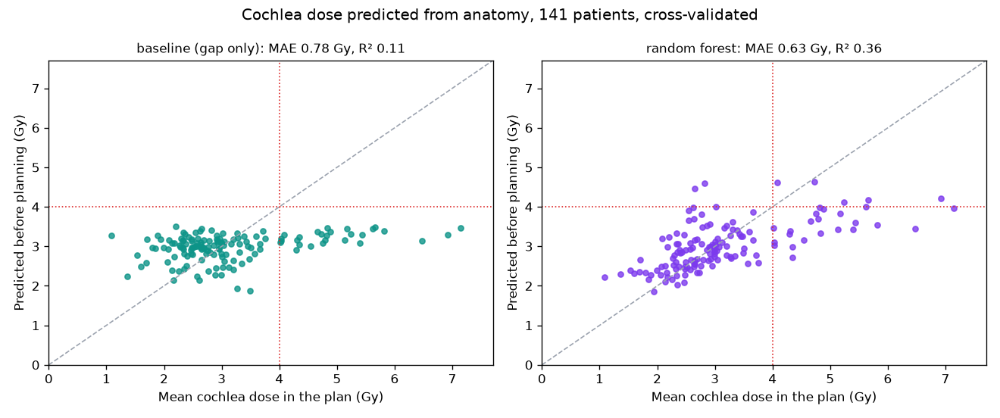

# Radiosurgery Dose Explorer

What did real Gamma Knife treatments of a brain tumour deliver, to the
tumour and to the hearing organ next to it? This project reads 59 real,
anonymised treatment plans, rebuilds the patients' anatomy from the
doctors' outlines, and measures every plan from its 3D dose: coverage,
conformity, dose fall-off, dose to the cochlea, the biological effect of
one large dose, and what small positioning errors would have changed.

It then uses all 242 patients in the collection for machine learning: a
deep learning model (a 3D U-Net) that outlines the tumour on the MRI, tested
on 60 patients it never saw, and a classic model that predicts the cochlea's
dose from the anatomy before any plan exists.

**See it:** https://letsapatiiso07.github.io/Radiosurgery-Dose-Explorer/ shows five
patients' MRI with the tumour, cochlea and dose lines, the AI's outline of
the tumour, their dose-volume histograms and plan numbers.

**How this was built:** I wrote this with Claude, Anthropic's AI assistant,
as a learning project. Claude wrote the first version of the code, tests and
this README. Every number below comes from running that code. Not for
clinical use.


## The condition and the treatment

A vestibular schwannoma (also called an acoustic neuroma) is a benign
tumour of the nerve that carries balance and hearing signals from the inner
ear to the brainstem. It can cause hearing loss and, if it grows, press on
the brainstem.

Gamma Knife radiosurgery treats it in one session. Around 200 beams of
gamma rays from cobalt-60 sources converge on a point, a "shot". Several
shots of different sizes are packed into the tumour so that a high dose
covers it and falls off steeply outside. The cochlea, the hearing organ, is
often only a few millimetres away.

## Who it is for

Anyone learning medical physics, radiotherapy planning, medical imaging or
machine learning in Python, and recruiters who want to see real clinical
data handled with care: file formats, anatomy, physics, biology, statistics
and machine learning in one pipeline, with honest test sets and the limits
stated.

## Results: the 59 plans

59 plans from a random sample of 60 patients (one was a meningioma, a
different tumour, and was left out). 52 were prescribed 13 Gy, 7 were
prescribed 12 Gy.

| Measure | Median | Middle half of plans |
|---|---|---|
| Tumour volume | 2.04 cc | 0.80 to 3.43 cc |
| Tumour covered by the prescription dose | 93.2% | 91.7 to 94.0% |
| Paddick conformity index (1 is perfect) | 0.83 | 0.78 to 0.86 |
| Gradient index (lower is a steeper fall-off) | 2.68 | 2.59 to 2.80 |
| Shots | 11 | 8 to 15 |
| Beam-on time | 45 min | 37 to 57 min |
| Normal tissue receiving 12 Gy or more | 0.34 cc | 0.23 to 0.59 cc |

### The hearing organ

33 plans had the cochlea outlined.

- **Mean cochlea dose:** median 2.86 Gy (middle half 2.52 to 3.35).
  27 of 33 plans (82%, 95% CI 65 to 93%) kept it under 4 Gy, a level linked
  to better hearing preservation in several published series.
- **The anatomy sets the risk.** The closer the tumour sits to the cochlea,
  the higher the cochlea dose (Spearman -0.60, 95% CI -0.82 to -0.29,
  p = 0.0002). Each extra millimetre of gap cut the mean cochlea dose by
  about 9% (factor 0.91 per mm, 95% CI 0.86 to 0.96). The gap was 2.2 mm
  in a typical plan and under 1 mm in several.


### Plan quality and tumour size

Larger tumours got more conformal plans (Spearman 0.81 between volume and
conformity), steeper fall-off (-0.42 with the gradient index) and more shots
(0.80). All three hold after Holm correction for four tests (p < 0.002).
Beam-on time did not clearly rise with volume (0.24, p = 0.07): it also
depends on how old the cobalt sources were.


### What one large dose means biologically

The linear-quadratic model turns dose into effect. For slow-responding
tissue such as nerve (alpha/beta about 2 to 3 Gy), 13 Gy in one session
equals about 42 to 49 Gy given in 2 Gy daily sessions (EQD2). The LQ model
may overstate the effect of large single doses, so the LQ-L variant, which
grows linearly above 6 Gy, gives a lower bound of about 32 to 37 Gy. The
truth for these patients probably sits between the two.


### What positioning errors would do

For the 33 plans with a cochlea outline, the dose pattern was moved by 200
random 3D shifts each and remeasured.

| Error per axis (average 3D shift) | Coverage lost, worst 5% of shifts | Extra mean cochlea dose, worst 5% |
|---|---|---|
| 0.5 mm (0.8 mm) | 10 percentage points (median) | +0.6 Gy |
| 1.0 mm (1.6 mm) | 25 percentage points (median) | +1.5 Gy |

Because the prescription dose hugs the tumour edge so tightly, sub-millimetre
accuracy matters. This is why Gamma Knife treatment uses a rigid head frame.


## How every number was checked

- **Against shapes with known answers (tests):** volumes of drawn
  cylinders, spheres and rings with holes; conformity and gradient indices
  on dose clouds where the answer can be worked out by hand; radiobiology
  formulas against hand calculations; the Monte Carlo shift against a known
  displacement.
- **Grid convergence:** coverage and conformity were remeasured on 0.5 mm
  and 0.25 mm grids for five plans. Coverage moved by under one percentage
  point, so the results do not depend on the 1 mm grid.
- **Against the clinical system:** for the one plan where the clinical
  system exported its own 13 Gy outline, my 13 Gy volume from the dose grid
  is 2.73 cc against its 2.83 cc (Dice overlap 0.89).
- **The exported dose runs about 1.5% low at the peak** (median, range
  0.3 to 4.1%), because a 1 mm grid misses the true maximum between voxels.
  Rescaling each dose to the maximum its plan implies raises median
  coverage from 93.2% to 94.1% and leaves conformity at 0.83. Both are
  reported; the rescaled figures carry about 1% uncertainty, since the plans
  state their isodose in whole percent.
- **The machine learning (tests):** the training, validation and test sets
  share no patient, and the test set is the dose sample; Dice and HD95 on
  shifted cubes with known answers; resampling exact on a linear ramp;
  outlines rasterised on an MRI grid; the AI probability turned into outlines
  keeps its volume; and the cochlea features are built with the dose and the
  shots replaced by a stand-in that fails on any use.

**Coverage is lower than the 95 to 99% often quoted** for these treatments.
The grid study shows it is not an artefact of my code. It may differ from the
clinical system's own figure, which uses a finer dose grid and its own reading
of the outlines between slices, and it also reflects plans that trade the
tumour edge against cochlea dose.

## Data quality findings

Each patient folder can hold more than one copy of the plan, outlines and
dose. A copy is used only if the dose, plan and outlines refer to each other
and the dose maximum fits the prescription and the plan's stated isodose
within 5%. Two copies failed:

- VS-SEG-001: one dose copy peaks at 10.75 Gy, impossible for a 13 Gy
  prescription at the 46% isodose; the other copy, 27.7 Gy, was used.
- VS-SEG-247: one plan copy contains no shots.

Across all 242 patients, for the machine learning:

- Every patient has two copies: one with the outlines drawn on the contrast
  T1 MRI and one with them drawn on the T2 MRI, each with its own dose. The
  dose analysis above takes the first sound copy (the T2 one for 32 of the
  60 patients); the machine learning always uses the T1 copy, the image the
  model reads. The two outlines of one tumour are close but not identical.
- VS-SEG-094, VS-SEG-163 and VS-SEG-174: both dose copies fail the check,
  their maxima 6 to 16% away from what the prescription and isodose imply.
- VS-SEG-222's plan prescribes 100 Gy, with the dose scaled to match. No
  schwannoma is treated with 100 Gy, so this plan is left out of the cochlea
  model.

The plans do not record each shot's collimator settings (every shot has the
same placeholder), so the dose could not be recalculated independently from
the shots. All dose numbers use the clinical system's own calculation (Leksell
GammaPlan, TMR10 algorithm).

## Deep learning: outlining the tumour on MRI

Before planning, a doctor outlines the tumour on the MRI, slice by slice. A
model that does this well could save time and give a second opinion. I
trained one and tested it on patients it never saw.

**Data and split.** All 242 patients: the contrast T1 MRI (512 x 512 pixels
of 0.41 mm, slices 1 or 1.5 mm apart) and the doctors' tumour outline drawn
on it. The test set is the 60 patients of the dose analysis, drawn at random
before any model existed (59 schwannomas and one meningioma). The other 182
were split at random into 162 for training and 20 for validation. No patient
is in two sets; a test checks this.

**Model.** Two small 3D U-Nets (Ronneberger et al. 2015; Çiçek et al. 2016)
in PyTorch, trained from scratch on a laptop CPU (8 cores, no GPU):

1. A coarse model reads the whole head on a 2 mm grid and marks where the
   tumour probably is.
2. A fine model reads a box around that mark on a 0.5 x 0.5 x 1.5 mm grid,
   close to the scan's own, and outlines the tumour. Its first level uses
   flat 1 x 3 x 3 filters, since the slices lie three times farther apart
   than the pixels, as in the dataset paper's 2.5D network.

Neither step uses the doctors' outline to decide where to look.

**Training.** Each step shows the model two patches (24 x 112 x 112 voxels,
36 x 56 x 56 mm, for the fine model) cut from random training patients. Most
are centred near the tumour, which fills well under 1% of the head; the rest
come from around it and from anywhere in the head, so the model also learns
what is not tumour. Patches are flipped left to right (the tumour can be on
either side), sometimes rotated and scaled, and their brightness jittered.
The labels are the share of each voxel inside the doctors' outline, from the
same sub-voxel code the dose analysis uses. The loss adds cross-entropy,
which scores every voxel, to Dice, which scores the overlap and so is not
swamped by the background. This recipe, and reading the image in overlapping
windows weighted toward their centres, follows nnU-Net (Isensee et al. 2021).
Seeds are fixed, and a stopped run resumes
exactly where it left off. The fine model trained for 12,000 steps and the
coarse model for 3,000 beside it, 3 hours 29 minutes in all. The coarse
model's first run learned nothing in 650 steps: its output started at 50%
everywhere, and with a typical tumour under 0.1% of each patch the
background swamped the Dice term. Starting the output at a low prior fixed it.

**Every choice made on validation.** Before the test patients were touched,
80 combinations were scored on the 20 validation patients: the checkpoint
with the best validation score or the last one, mirroring the image left to
right and averaging the two answers, checking one or two candidate regions,
five probability thresholds, and keeping only the largest region or not. The
best mean Dice won (0.941, all 20 tumours found): the step-11,500 checkpoint,
mirroring on, one candidate, threshold 0.5, largest region only
(`results/segmentation_validation.json`). The 60 test patients were then
scored once. Outlining one patient takes about 4 seconds on the CPU.

### Results on the 60 test patients

Scored on the MRI's own grid against the doctors' T1 outline, with bootstrap
95% CIs. Dice is twice the overlap divided by the two volumes added; 1 is a
perfect match. HD95 is how far the edges stray, ignoring the worst 5% of
edge points.

| Measure | This model | Published model (Shapey et al. 2021) |
|---|---|---|
| Mean Dice | 0.934 (0.922 to 0.945), SD 0.046 | 0.945, SD 0.022 |
| Median Dice | 0.950 (0.935 to 0.956) | not reported |
| HD95, median | 0.92 mm (0.82 to 1.08) | not reported |
| Tumours found | 60 of 60 (94 to 100%) | not reported |
| AI volume minus doctors' | +0.03 cc (-0.02 to +0.07), 95% limits -0.33 to +0.38 cc | not reported |



**Where this lands.** The model's outlines agree with the doctors' a little
less than the published model's did: a mean Dice of 0.934 against 0.945. The
published figure sits at the top edge of this model's 95% interval, and the
two were scored on different patients (60 here; the paper set aside 46 for
testing), so the gap is rough. For scale, two clinicians' outlines of the
same tumours agreed at a Dice of 0.938 (SD 0.031) in the dataset paper, and
on these 60 patients the
doctors' own outline on the T2 scan agrees with their T1 outline at 0.937
(0.926 to 0.947). For most patients the AI differs from the doctors about as
much as their two outlines differ from each other.

**Why it falls short of the published model.**

- Compute: 3.5 hours on a laptop CPU, about 24,000 training patches. A GPU
  allows far longer training and larger networks.
- A plainer network: the published one adds an attention module and a loss
  that weights hard voxels more (Wang et al. 2019).
- Fewer training patients: 162 against 176.
- The test set includes one meningioma, a different tumour, which scores
  worst (0.74). Without it the mean is 0.938.

**Where it errs.** Small tumours are harder, since the same 0.4 mm edge error
is a larger share of a small volume: median Dice 0.928 for the 18 tumours
under 1 cc against 0.957 for the 42 above. Eight test patients scored below
0.90: the meningioma, three tumours under 0.5 cc, and four larger ones where
the AI's edge strayed from the doctors' (HD95 up to 3.8 mm).



**Limits.** One hospital, one scanner type (1.5 T Siemens) and one team's way
of outlining; contrast T1 only. With 60 test patients every figure carries
the interval shown. The model has not seen scans from elsewhere, where
contrast and resolution differ. Not for clinical use.

## Does the AI outline change the plan scores?

For the 59 schwannoma test patients, each plan was scored twice on the same
dose: once with the doctors' T1 outline and once with the AI's. The AI
outline is turned into slice-by-slice polygons like a doctor's and goes
through the same code. The dose is the copy registered to T1 for 57 plans and
the other copy for the 2 whose T1 dose failed the sanity check. The doctors'
figures here use the T1 outline, so they differ slightly from the table at
the top, which takes the first sound copy.

| Plan score | Doctors' outline, median | AI outline, median | Difference, median (95% CI) | 95% limits of agreement |
|---|---|---|---|---|
| Coverage | 92.2% | 90.7% | -1.6 points (-2.5 to -0.8) | -11.6 to +7.0 points |
| Paddick conformity index | 0.827 | 0.807 | -0.011 (-0.018 to -0.009) | -0.092 to +0.046 |

The gradient index depends on the dose alone, so it cannot change; it did
not. 12 of the 59 plans moved by more than 5 points of coverage. The largest
moves: VS-SEG-135 (89.0% with the doctors' outline, 65.5% with the AI's),
VS-SEG-141 (85.8% to 72.7%) and VS-SEG-026 (95.0% to 82.2%).



**What it means in practice.**

- The plan was shaped around the doctors' outline, so the prescription dose
  hugs it. Where the AI outline reaches beyond it, it adds tissue the dose
  was never meant to cover, and coverage falls; where it cuts inside,
  coverage looks better than it is. The change in coverage follows the
  change in volume closely (Spearman -0.83, 95% CI -0.91 to -0.70).
- In 18 of the 59 plans, coverage looked better with the AI outline. A plan
  built on an outline that is too small would score well while part of the
  real tumour got too little dose: plan scores inherit an outline error,
  they cannot catch it.
- Averaged over many plans, the AI outline moves coverage by under 2 points,
  close enough to compare groups of plans. For one patient it can be more
  than 10 points off, so a doctor must still check every outline.

## Machine learning: the cochlea dose before planning

The cochlea's dose depends on how the plan is shaped, but the anatomy sets
the odds. If the outlines alone can predict it, a team could see before
planning which patients risk a high dose to the hearing organ.

**Data.** Every patient in the collection with a cochlea outline and a plan
that passes the sanity check: 141 patients (119 prescribed 13 Gy, 22
prescribed 12 Gy). The other 101 have no cochlea outline or a different
tumour (97), fail the dose check (3) or were prescribed 100 Gy (1). Mean
cochlea dose: median 2.86 Gy, middle half 2.42 to 3.47 Gy.

**Features, all known before planning.** They come from the doctors'
outlines and the prescribed dose only; a test checks that the feature code
never reads the dose or the plan's shots.

- tumour and cochlea volumes;
- the closest gap between them and the distance between their centres;
- the tumour volume within 5 mm and within 10 mm of the cochlea, a simple
  measure of how far the tumour fills the internal auditory canal toward the
  cochlea;
- the prescription.

**Target.** Mean cochlea dose as a share of the prescription, since plans
scale with it. Predictions are multiplied back and scored in Gy.

**Models and scoring.** The baseline is the one-line fit from the dose
analysis: log dose falls in a straight line with the gap. Against it: ridge
regression on log dose, gradient boosting and a random forest. Each is scored
by 5-fold cross-validation repeated 10 times: fitted on four fifths of the
patients, it predicts the fifth it never saw. Its settings (a small grid) are
chosen by a further 5-fold search inside each training part, so the held-out
patients never steer them. Intervals are bootstrap 95% CIs over patients.

| Model | Mean absolute error | R² | Error minus the baseline's |
|---|---|---|---|
| Baseline: gap only | 0.78 Gy (0.67 to 0.89) | 0.11 (0.02 to 0.17) | |
| Ridge regression | 0.64 Gy (0.55 to 0.74) | 0.36 (0.21 to 0.47) | -0.14 Gy (-0.22 to -0.05) |
| Gradient boosting | 0.63 Gy (0.55 to 0.73) | 0.37 (0.21 to 0.48) | -0.14 Gy (-0.22 to -0.06) |
| Random forest | 0.63 Gy (0.54 to 0.73) | 0.36 (0.24 to 0.45) | -0.15 Gy (-0.22 to -0.08) |

All three beat the baseline on the same patients (paired Wilcoxon test,
p < 0.001).

**Will the cochlea get 4 Gy or more?** 27 of the 141 plans did. Ranking
patients by the gap alone separates them with an AUC of 0.81 (0.73 to 0.89);
logistic regression on all the features reaches 0.87 (0.81 to 0.93), gradient
boosting 0.83 (0.75 to 0.90).



**What it means.** Machine learning beats the one-line formula clearly but
modestly: errors fall by about a fifth, and the share of the variation
explained rises from 11% to about 36%. The three models score alike, so the
gain comes from the extra features, not the algorithm. In the ridge model,
tumour volume weighs most: one standard deviation more (on a log scale) goes
with 34% more cochlea dose, perhaps because bigger tumours get bigger shots
whose dose spreads further. Tumour within 5 mm of the cochlea adds 14%; one
standard deviation more gap or centre distance takes off 9 to 11%. The
features overlap, so these single weights are rough. About two thirds of the
variation stays unexplained: it lies in how the planner shaped the dose,
which the anatomy cannot know. The models also pull extreme cases toward the
middle, so they underrate the highest doses (right panel).

Over all 141 patients, each extra millimetre of gap cuts the mean cochlea
dose by about 6% (factor 0.94 per mm, 95% CI 0.91 to 0.97), a gentler slope
than the 9% in the 33-plan sample above.

**Limits.** One hospital and one planning team, so the models learn their
habits. Cross-validation reuses the same 141 patients; there is no outside
test. Only 27 patients reached 4 Gy, so the AUCs are uncertain.

## How to run it

```bash
pip install -r requirements.txt
python -m radiosurgery.download
python run.py
pytest
```

The download takes the plan, outlines and dose for 60 randomly chosen
patients (fixed seed) and the planning MRI for five of them, about 1.7 GB. The
analysis takes about two and a half minutes. On a machine without a GPU,
install the smaller CPU build of PyTorch first:
`pip install torch --index-url https://download.pytorch.org/whl/cpu`.

The machine learning needs every patient:

```bash
python -m radiosurgery.download --all     # about 21 GB; add --gcs if the Amazon copy cannot be reached
python run_ml.py
python run.py                             # redraws the viewer with the AI outlines
```

`run_ml.py` prepares the MRI (4 minutes with 8 processes), trains both
models (about four hours on an 8-core laptop CPU, no GPU), makes every choice
on the validation patients, scores the test patients once, compares the plan
scores, draws the figures and runs the cochlea model (30 minutes). Each step
also runs alone; the list is in the script. Training saves a checkpoint
every 250 steps and carries on from the last one if run again. The model
weights stay out of git, in `models/`; this rebuilds them.

The viewer in `docs/` shows five patients' MRI slices with outlines (the
AI's too), isodose lines, dose-volume histograms and plan numbers. Serve the folder with
`python -m http.server --directory docs` and open it in a browser.


## What I learned

[FILL IN: two or three sentences in your own words, once you have worked
through the code. For example: why the gap to the cochlea matters so much,
what the gradient index tells you that coverage does not, or why one large
dose is biologically different from many small ones.]

## Project layout

```
radiosurgery/download.py      random patient sample from the Imaging Data Commons
radiosurgery/dicomrt.py       DICOM-RT plan, outlines and dose, with the sanity check
radiosurgery/masks.py         outlines to 3D masks with sub-voxel sampling
radiosurgery/metrics.py       DVH, coverage, Paddick CI, gradient index, V12, distances
radiosurgery/radiobiology.py  LQ and LQ-L models, BED and EQD2
radiosurgery/robustness.py    Monte Carlo positioning errors
radiosurgery/stats.py         bootstrap, Spearman, Holm, Bland-Altman, exact intervals
radiosurgery/mri.py           the planning MRI, for pictures and the model
radiosurgery/seg/data.py      T1 MRI and the doctors' outline on the model grids
radiosurgery/seg/splits.py    training, validation and test patients (data/splits.json)
radiosurgery/seg/unet.py      the 3D U-Net
radiosurgery/seg/train.py     training, with checkpoints and resume
radiosurgery/seg/infer.py     coarse-to-fine outlining
radiosurgery/seg/evaluate.py  Dice, HD95, volume; choices on validation, one test run
radiosurgery/seg/plans.py     plan scores with the AI outline
radiosurgery/seg/figures.py   pictures of the AI outlines
radiosurgery/cochlea_ml.py    cochlea dose from anatomy, cross-validated
run.py                        the dose study, charts, results/metrics.json, viewer data
run_ml.py                     every machine learning step, in order
tests/                        30 tests
```

## Data and references

- Shapey, J. et al. (2021). Segmentation of vestibular schwannoma from MRI, an open annotated dataset and baseline algorithm. Scientific Data 8:286. Data: The Cancer Imaging Archive, DOI 10.7937/TCIA.9YTJ-5Q73, CC BY 4.0, served by the NCI Imaging Data Commons.
- Paddick, I. (2000). A simple scoring ratio to index the conformity of radiosurgical treatment plans. Journal of Neurosurgery 93.
- Paddick, I. and Lippitz, B. (2006). A simple dose gradient measurement tool to complement the conformity index. Journal of Neurosurgery 105.
- Astrahan, M. (2008). Some implications of linear-quadratic-linear radiation dose-response with regard to hypofractionation. Medical Physics 35(9).
- Bland, J. and Altman, D. (1986). Statistical methods for assessing agreement between two methods of clinical measurement. The Lancet 327.
- Ronneberger, O., Fischer, P. and Brox, T. (2015). U-Net: convolutional networks for biomedical image segmentation. MICCAI 2015.
- Çiçek, Ö. et al. (2016). 3D U-Net: learning dense volumetric segmentation from sparse annotation. MICCAI 2016.
- Wang, G., Shapey, J. et al. (2019). Automatic segmentation of vestibular schwannoma from T2-weighted MRI by deep spatial attention with hardness-weighted loss. MICCAI 2019.
- Isensee, F. et al. (2021). nnU-Net: a self-configuring method for deep learning-based biomedical image segmentation. Nature Methods 18.

## Author

Tiiso Letsapa, Letsapamyron07@gmail.com

Copyright Tiiso Letsapa. All rights reserved, see [LICENSE](LICENSE).
