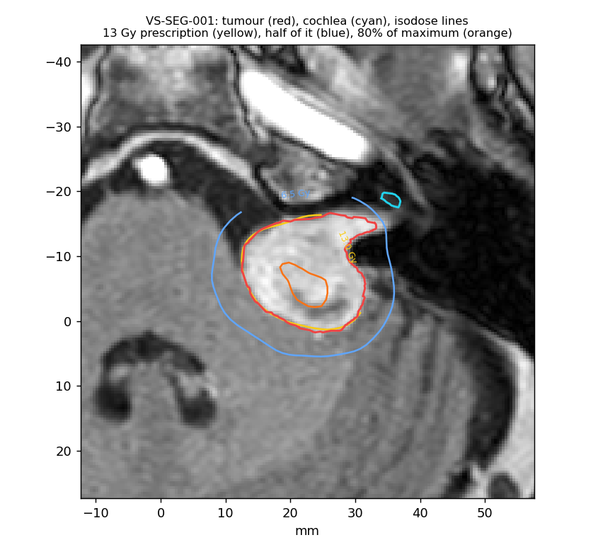
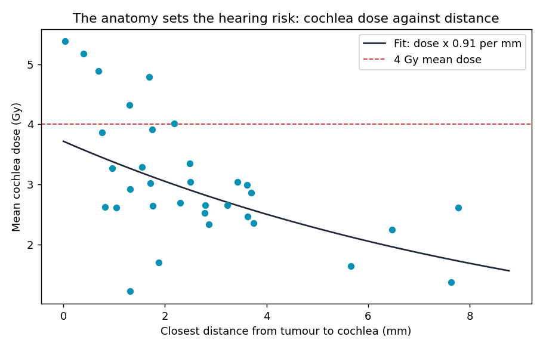
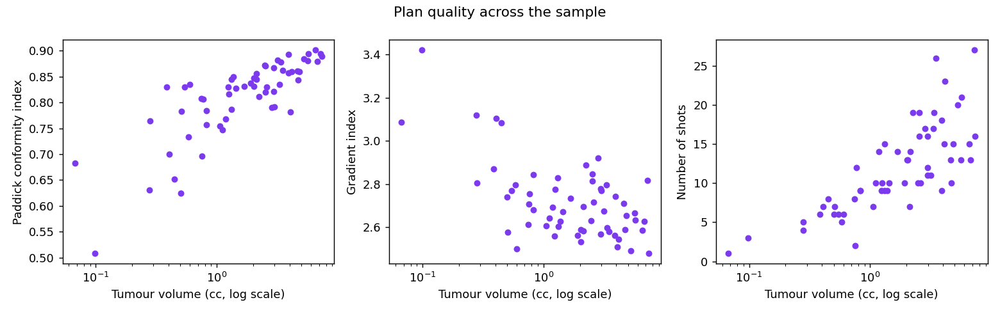
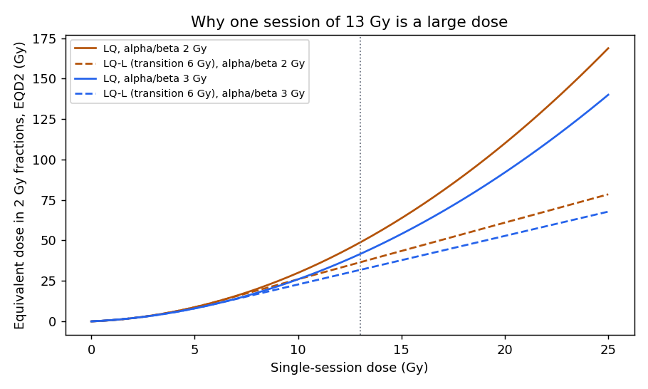
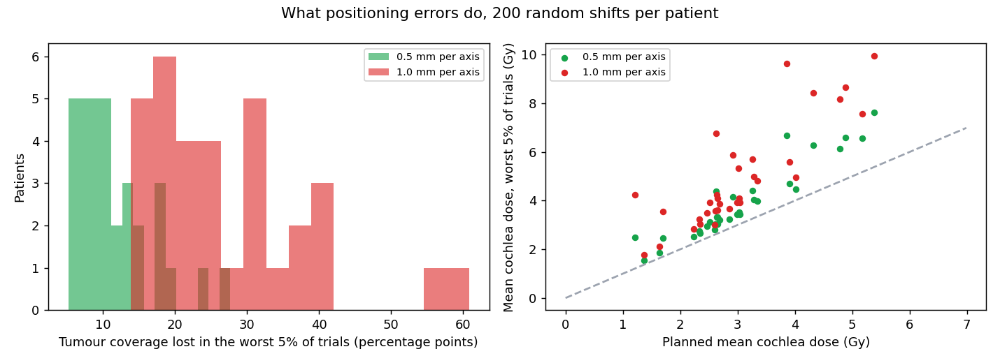
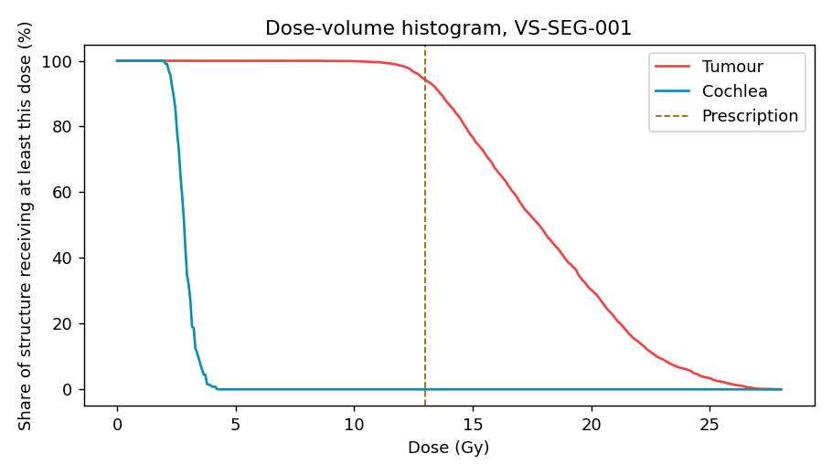

# Radiosurgery Dose Explorer

What did real Gamma Knife treatments of a brain tumour deliver, to the
tumour and to the hearing organ next to it? This project reads 59 real,
anonymised treatment plans, rebuilds the patients' anatomy from the
doctors' outlines, and measures every plan from its 3D dose: coverage,
conformity, dose fall-off, dose to the cochlea, the biological effect of
one large dose, and what small positioning errors would have changed.

**How this was built:** I wrote this with Claude, Anthropic's AI assistant,
as a learning project. Claude wrote the first version of the code, tests and
this README. Every number below comes from running that code. Not for
clinical use.



## The condition and the treatment

A vestibular schwannoma (also called an acoustic neuroma) is a benign
tumour of the nerve that carries balance and hearing signals from the inner
ear to the brainstem. It can cause hearing loss and, if it grows, press on
the brainstem.

Gamma Knife radiosurgery treats it in one session. Around 200 beams of
gamma rays from cobalt-60 sources converge on a point, a "shot". Several
shots of different sizes are packed into the tumour so that a high dose
covers it and falls off steeply outside. The cochlea, the hearing organ, is
often only a few millimetres away.

## Who it is for

Anyone learning medical physics, radiotherapy planning or medical imaging
in Python, and recruiters who want to see real clinical data handled with
care: file formats, anatomy, physics, biology and statistics in one
pipeline, with the limits stated.

## Results

59 plans from a random sample of 60 patients (one was a meningioma, a
different tumour, and was left out). 52 were prescribed 13 Gy, 7 were
prescribed 12 Gy.

| Measure | Median | Middle half of plans |
|---|---|---|
| Tumour volume | 2.04 cc | 0.80 to 3.43 cc |
| Tumour covered by the prescription dose | 93.2% | 91.7 to 94.0% |
| Paddick conformity index (1 is perfect) | 0.83 | 0.78 to 0.86 |
| Gradient index (lower is a steeper fall-off) | 2.68 | 2.59 to 2.80 |
| Shots | 11 | 8 to 15 |
| Beam-on time | 45 min | 37 to 57 min |
| Normal tissue receiving 12 Gy or more | 0.34 cc | 0.23 to 0.59 cc |

### The hearing organ

33 plans had the cochlea outlined.

- **Mean cochlea dose:** median 2.86 Gy (middle half 2.52 to 3.35).
  27 of 33 plans (82%, 95% CI 65 to 93%) kept it under 4 Gy, a level linked
  to better hearing preservation in several published series.
- **The anatomy sets the risk.** The closer the tumour sits to the cochlea,
  the higher the cochlea dose (Spearman -0.60, 95% CI -0.82 to -0.29,
  p = 0.0002). Each extra millimetre of gap cut the mean cochlea dose by
  about 9% (factor 0.91 per mm, 95% CI 0.86 to 0.96). The gap was 2.2 mm
  in a typical plan and under 1 mm in several.



### Plan quality and tumour size

Larger tumours got more conformal plans (Spearman 0.81 between volume and
conformity), steeper fall-off (-0.42 with the gradient index) and more shots
(0.80). All three hold after Holm correction for four tests (p < 0.002).
Beam-on time did not clearly rise with volume (0.24, p = 0.07): it also
depends on how old the cobalt sources were.



### What one large dose means biologically

The linear-quadratic model turns dose into effect. For slow-responding
tissue such as nerve (alpha/beta about 2 to 3 Gy), 13 Gy in one session
equals about 42 to 49 Gy given in 2 Gy daily sessions (EQD2). The LQ model
may overstate the effect of large single doses, so the LQ-L variant, which
grows linearly above 6 Gy, gives a lower bound of about 32 to 37 Gy. The
truth for these patients probably sits between the two.



### What positioning errors would do

For the 33 plans with a cochlea outline, the dose pattern was moved by 200
random 3D shifts each and remeasured.

| Error per axis (average 3D shift) | Coverage lost, worst 5% of shifts | Extra mean cochlea dose, worst 5% |
|---|---|---|
| 0.5 mm (0.8 mm) | 10 percentage points (median) | +0.6 Gy |
| 1.0 mm (1.6 mm) | 25 percentage points (median) | +1.5 Gy |

Because the prescription dose hugs the tumour edge so tightly, sub-millimetre
accuracy matters. This is why Gamma Knife treatment uses a rigid head frame.



## How every number was checked

- **Against shapes with known answers (tests):** volumes of drawn
  cylinders, spheres and rings with holes; conformity and gradient indices
  on dose clouds where the answer can be worked out by hand; radiobiology
  formulas against hand calculations; the Monte Carlo shift against a known
  displacement.
- **Grid convergence:** coverage and conformity were remeasured on 0.5 mm
  and 0.25 mm grids for five plans. Coverage moved by under one percentage
  point, so the results do not depend on the 1 mm grid.
- **Against the clinical system:** for the one plan where the clinical
  system exported its own 13 Gy outline, my 13 Gy volume from the dose grid
  is 2.73 cc against its 2.83 cc (Dice overlap 0.89).
- **The exported dose runs about 1.5% low at the peak** (median, range
  0.3 to 4.1%), because a 1 mm grid misses the true maximum between voxels.
  Rescaling each dose to the maximum its plan implies raises median
  coverage from 93.2% to 94.1% and leaves conformity at 0.83. Both are
  reported; the rescaled figures carry about 1% uncertainty, since the plans
  state their isodose in whole percent.

**Coverage is lower than the 95 to 99% often quoted** for these treatments.
The grid study shows it is not an artefact of my code. It may differ from the
clinical system's own figure, which uses a finer dose grid and its own reading
of the outlines between slices, and it also reflects plans that trade the
tumour edge against cochlea dose.

## Data quality findings

Each patient folder can hold more than one copy of the plan, outlines and
dose. A copy is used only if the dose, plan and outlines refer to each other
and the dose maximum fits the prescription and the plan's stated isodose
within 5%. Two copies failed:

- VS-SEG-001: one dose copy peaks at 10.75 Gy, impossible for a 13 Gy
  prescription at the 46% isodose; the other copy, 27.7 Gy, was used.
- VS-SEG-247: one plan copy contains no shots.

The plans do not record each shot's collimator settings (every shot has the
same placeholder), so the dose could not be recalculated independently from
the shots. All dose numbers use the clinical system's own calculation (Leksell
GammaPlan, TMR10 algorithm).

## How to run it

```bash
pip install -r requirements.txt
python -m radiosurgery.download
python run.py
pytest
```

The download takes the plan, outlines and dose for 60 randomly chosen
patients (fixed seed) and the planning MRI for five of them, about 1.7 GB. The
analysis takes about two and a half minutes.

The viewer in `docs/` shows five patients' MRI slices with outlines, isodose
lines, dose-volume histograms and plan numbers. Serve the folder with
`python -m http.server --directory docs` and open it in a browser.



## What I learned

[FILL IN: two or three sentences in your own words, once you have worked
through the code. For example: why the gap to the cochlea matters so much,
what the gradient index tells you that coverage does not, or why one large
dose is biologically different from many small ones.]

## Project layout

```
radiosurgery/download.py      random patient sample from the Imaging Data Commons
radiosurgery/dicomrt.py       DICOM-RT plan, outlines and dose, with the sanity check
radiosurgery/masks.py         outlines to 3D masks with sub-voxel sampling
radiosurgery/metrics.py       DVH, coverage, Paddick CI, gradient index, V12, distances
radiosurgery/radiobiology.py  LQ and LQ-L models, BED and EQD2
radiosurgery/robustness.py    Monte Carlo positioning errors
radiosurgery/stats.py         bootstrap, Spearman, Holm, Bland-Altman, exact intervals
radiosurgery/mri.py           the planning MRI, for pictures
run.py                        the whole study, charts, results/metrics.json, viewer data
tests/                        18 tests
```

## Data and references

- Shapey, J. et al. (2021). Segmentation of vestibular schwannoma from MRI, an open annotated dataset and baseline algorithm. Scientific Data 8:286. Data: The Cancer Imaging Archive, DOI 10.7937/TCIA.9YTJ-5Q73, CC BY 4.0, served by the NCI Imaging Data Commons.
- Paddick, I. (2000). A simple scoring ratio to index the conformity of radiosurgical treatment plans. Journal of Neurosurgery 93.
- Paddick, I. and Lippitz, B. (2006). A simple dose gradient measurement tool to complement the conformity index. Journal of Neurosurgery 105.
- Astrahan, M. (2008). Some implications of linear-quadratic-linear radiation dose-response with regard to hypofractionation. Medical Physics 35(9).
- Bland, J. and Altman, D. (1986). Statistical methods for assessing agreement between two methods of clinical measurement. The Lancet 327.

## Author

Tiiso Letsapa, Letsapamyron07@gmail.com
